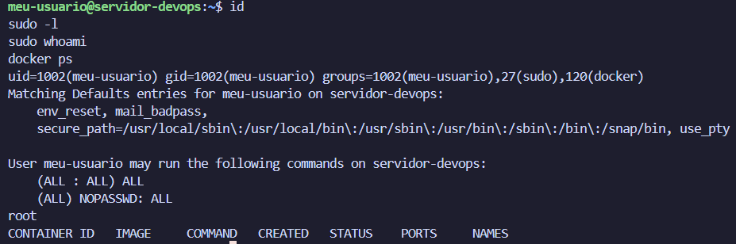

# Evidências da Atividade: Cloud-Init (DevOps)

Evidências de validação do ambiente provisionado automaticamente com Cloud-Init e Vagrant.

---

## 1. Serviços Ativos, Usuário e Cloud-Init

Verificação da conclusão do Cloud-Init (`status: done`) e dos serviços **Nginx** e **Docker** ativos e habilitados:

- `cloud-init status --long`
- `systemctl status nginx`
- `systemctl status docker`
- `id meu-usuario`


---

## 2. Acesso SSH com Chave Pública e Permissões Administrativas

Acesso SSH realizado a partir do Windows usando o par de chaves OpenSSH Ed25519 (`id_ed25519`):

- **Autenticação:** Chave privada preservada no host cliente e chave pública injetada pelo Cloud-Init em `~/.ssh/authorized_keys`.
- **Privilégios:** Usuário `meu-usuario` com permissão total via `sudo` sem necessidade de senha (`NOPASSWD: ALL`).
- **Grupo Docker:** Usuário adicionado ao grupo `docker` via `runcmd`, permitindo executar containers sem `sudo`.

```powershell
ssh -i "$HOME\.ssh\id_ed25519" -p 2222 meu-usuario@127.0.0.1 "whoami; sudo whoami; docker ps"
```



---

## 3. Página Web Personalizada em Execução

Página HTML servida pelo **Nginx** a partir do diretório `/var/www/html/index.html` (criada através do módulo `write_files` do Cloud-Init):


*Acesso verificado pela porta encaminhada no Vagrantfile e pela interface de rede privada.*
