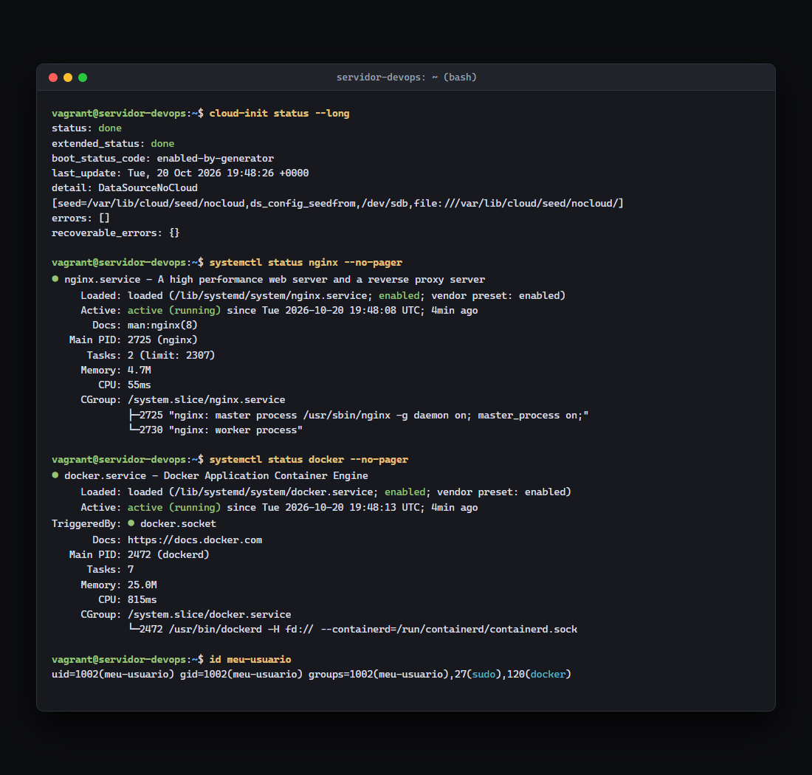
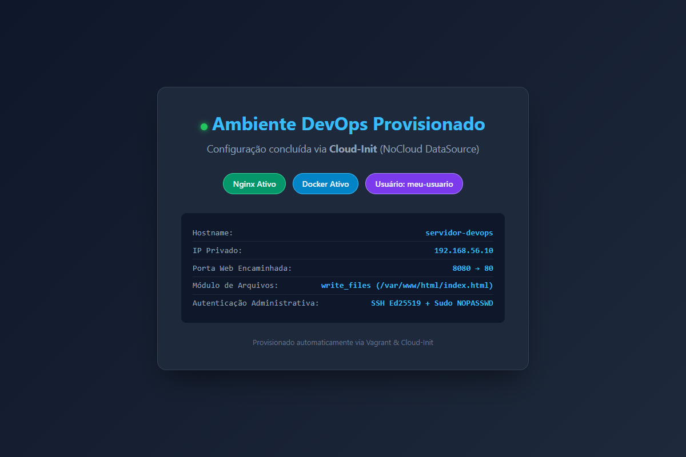

# Evidências da Atividade: Cloud-Init (DevOps)

Validação realizada em 20 de outubro de 2026.

## 1. Resumo do Provisionamento

A infraestrutura foi automatizada utilizando o **Cloud-Init** com a fonte de metadados local `DataSourceNoCloud`. O arquivo `user-data` configurou:
- Atualização do índice de repositórios do sistema (`package_update: true`);
- Criação declarativa do usuário administrador `meu-usuario` com permissões `sudo` sem senha (`NOPASSWD: ALL`) e chave pública OpenSSH (`ed25519`);
- Instalação dos pacotes essenciais `docker.io` e `nginx` pelo gerenciador APT;
- Publicação de página HTML personalizada em `/var/www/html/index.html` com o módulo `write_files`;
- Ativação imediata e habilitação no boot dos serviços Nginx e Docker via `runcmd`;
- Inclusão do usuário `meu-usuario` no grupo `docker` via `runcmd`;
- Emissão de mensagem conclusiva `final_message` nos logs do sistema.

---

## 2. Status do Cloud-Init e Serviços

O Cloud-Init concluiu a execução com status `done` e sem nenhum erro. Os serviços Nginx e Docker estão ativos (`running`) e habilitados no systemd.



Os registros detalhados de logs podem ser conferidos em:
- [01-cloud-init.txt](01-cloud-init.txt)
- [03-servicos-e-docker.txt](03-servicos-e-docker.txt)

---

## 3. Usuário Administrador e Chave SSH

A chave SSH do tipo `ed25519` foi gerada no Windows com o comando `ssh-keygen`:
- **Chave Privada:** mantida com segurança em `%USERPROFILE%\.ssh\id_ed25519` (não exposta no repositório);
- **Chave Pública:** declarada no campo `ssh_authorized_keys` do `user-data`.

A autenticação SSH via Windows PowerShell foi validada com sucesso:

```powershell
ssh -i "$HOME\.ssh\id_ed25519" -o StrictHostKeyChecking=no -p 2222 meu-usuario@127.0.0.1 "whoami; sudo whoami; docker ps"
```

Saída observada:
```text
meu-usuario
root
CONTAINER ID   IMAGE     COMMAND   CREATED   STATUS    PORTS     NAMES
```

O arquivo de evidências do usuário está em [02-usuario-e-ssh.txt](02-usuario-e-ssh.txt).

---

## 4. Página Web Personalizada

A página HTML foi servida pelo Nginx a partir do caminho `/var/www/html/index.html`, possuindo permissões `0644` e proprietário `www-data:www-data`.

Como a porta `8080` do host já se encontrava ocupada por uma aplicação Java pré-existente no Windows, o mecanismo `auto_correct: true` do Vagrant encaminhou automaticamente o tráfego da porta guest `80` para a porta host `2200`. Além disso, a página está acessível pelo IP da rede privada `192.168.56.10`.



A validação das requisições HTTP e headers está registrada em [04-validacao-web.txt](04-validacao-web.txt).

